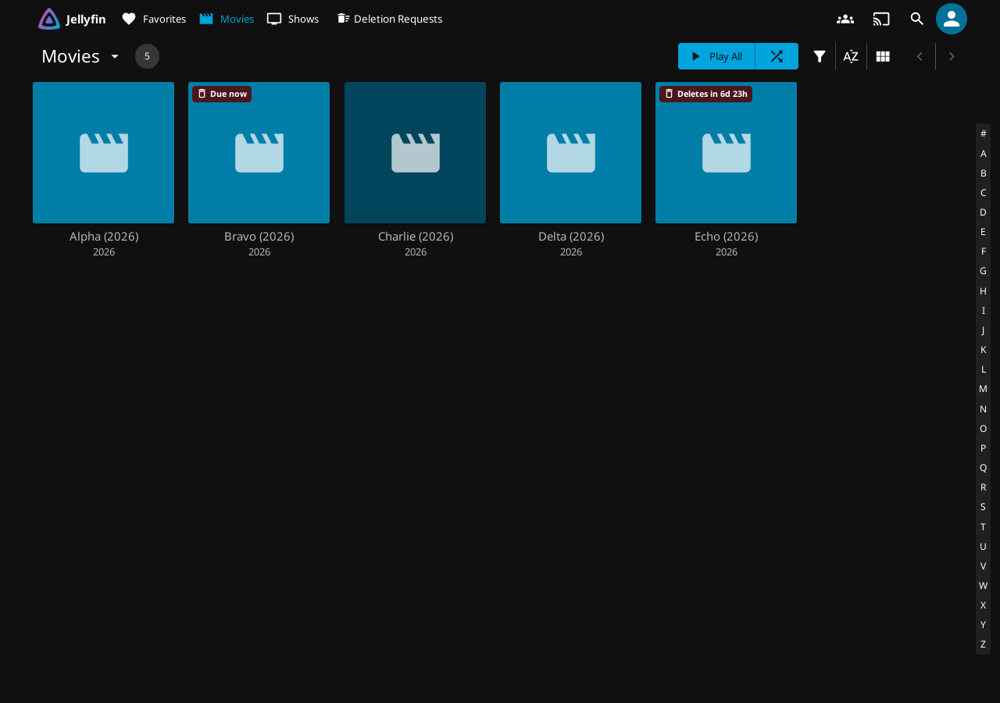
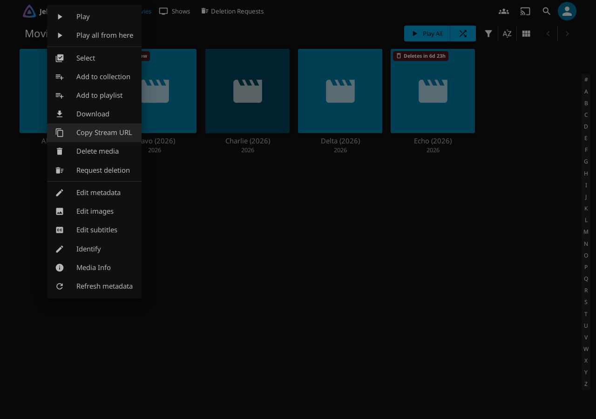
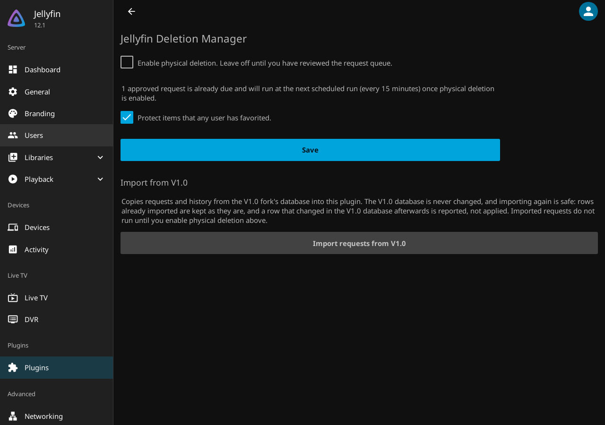

# Jellyfin Deletion Manager Plugin

[](https://github.com/PACE-1/Jellyfin-Deletion-Manager-Plugin/actions/workflows/tests.yml)

Let your Jellyfin users ask for media to be removed, and let you review, schedule and safely carry out those requests from inside Jellyfin. It is a single plugin for a vanilla Jellyfin 12.1 server: no other plugin is needed.


## What it does

- **Request.** A "Request Deletion" button on movie, series, season and episode pages and in the item menu, with the exact item count and an optional reason.
- **Review.** A "Deletion Requests" dashboard with My Requests, Pending, Approved and History, search and filters, bulk approve and deny, and a timeline for each request.
- **Schedule.** Approve for now, 1 week, 2 weeks or 1 month. Cancel any time before it runs. Approved media shows a countdown on its library cards for everyone who can see it.
- **Stay safe.** Physical deletion is **off until you turn it on**. When on, anything a user has favorited or that is playing is never deleted, and each request is checked against the library as it is when the request runs.

| Library cards | Item menu | Settings |
|---|---|---|
|  |  |  |

## Requirements

Jellyfin **12.1** (.NET 10). Jellyfin 10.11 is not supported; the plugin will not load there, and the server keeps running.

## Install

**From the plugin catalog.** In Jellyfin: Dashboard, Plugins, Repositories, add

```
https://raw.githubusercontent.com/PACE-1/Jellyfin-Deletion-Manager-Plugin/main/manifest.json
```

then install "Jellyfin Deletion Manager" from the catalog and restart Jellyfin.

**By hand.** Download `jellyfin-deletion-manager_<version>.zip` from the [latest release](https://github.com/PACE-1/Jellyfin-Deletion-Manager-Plugin/releases/latest), check it against `SHA256SUMS`, unpack it into a new folder `<jellyfin data>/plugins/Jellyfin Deletion Manager_<version>/`, and restart Jellyfin.

Nothing is written to Jellyfin's web folder, and no File Transformation or JavaScript Injector plugin is needed.

## First use

1. Open Dashboard, Plugins, Jellyfin Deletion Manager. Leave **Enable physical deletion** off while you try it.
2. As any user, open a movie and choose **Request Deletion**. As an administrator, open **Deletion Requests** in the top bar and approve or deny.
3. When you trust the queue, turn **Enable physical deletion** on. Approved requests run from the scheduled task "Process Media Deletion Requests" (every 15 minutes) once they are due.

## Documentation

- [How it works](docs/ARCHITECTURE.md)
- [Testing](docs/TESTING.md)
- [Making a release](docs/RELEASING.md)

## Contributing

Forks and pull requests are welcome; see [CONTRIBUTING.md](CONTRIBUTING.md). Report security problems as described in [SECURITY.md](SECURITY.md).

## Licence and credits

Free and open source under GPL-3.0, see [LICENSE](LICENSE). The project asks for no money and takes no donations.

You are free to fork, change and redistribute it. The licence asks for credit: keep [NOTICE.md](NOTICE.md) and the copyright lines, say what you changed, and share your version under the same licence with its source. If you publish a fork, please link back to this repository.

Some code is adapted from [Jellyfin Enhanced](https://github.com/n00bcodr/Jellyfin-Enhanced) by n00bcodr and its contributors (GPL-3.0); see [NOTICE.md](NOTICE.md). Thank you to that project.
